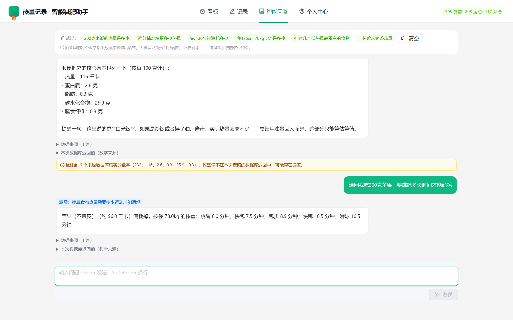

<div align="center">

# Calorie Coach

**让 LLM 只能引用数据库里的数字 —— 一个数值可信的 AI 营养助手**

[]()
[]()
[]()
[]()
[]()

[快速开始](#快速开始) · [核心方案](#核心方案) · [技术亮点](#技术亮点) · [设计文档](docs/DESIGN.md)

</div>

---

## 问题：AI 给健康建议，最危险的是编数字

市面上的 AI 营养助手大多是「LLM 自由回答」。问题不在于答不上，
而在于**它会编数字**。

> BMR 算成 1720 还是 1820，差 100 千卡就是一天的热量差。
> 一个用户按错误的 BMR 吃一个月，累积偏差可达 3 万千卡。

本项目的做法是**结构性约束**：系统里的每个数字都必须可追溯到数据库，
模型只负责「把已确定的数字组织成自然语言」。



上图中，每个热量数字都能点开查看数据库原始返回值。

---

## 核心方案：可信算术

**不让模型算，但也不禁止它算 —— 而是让它只能用数据库的数字算。**

```python
{{calc: met_1 * weight_kg_1 * 30 / 60}}
       └── 系统真实执行这个算式并填入结果
```

### 为什么这能根治

|环节 | 可能幻觉？ |
|---|---|
|模型**运算** | ❌ 运算确定，不产生幻觉 |
| 模型的**输入** | ❌ 全部来自数据库槽位 |

幻觉只可能来自输入，而输入全部可追溯 —— 于是「算」这一步天然没有幻觉风险。

### 关键：不靠穷举意图

只要 MET 和体重两个原料给出去，所有算术类问题都能解：

```
「快走30分钟消耗多少」    ✅
「走路消耗多少」          ✅
「慢跑消耗大吗」          ✅
「吃完汉堡要跳多久绳」     ✅
「我吃200克苹果要跑多久」   ✅
```

**泄漏率从 9/21 降到 0/21**，连续三轮稳定。

### 安全边界

算术引擎用 **AST 白名单求值，不是 `eval`**。只允许
`Constant / Name / BinOp / UnaryOp` 四类节点，23 项攻击全部拦截：

```
❌ __import__('os').system('ls')      ❌ met.__class__
❌ print('hi')                  ❌ [1,2,3][0]
❌ met ** 1000                ❌ eval('1+1')
❌ 除以零 / 未知变量 / lambda / f字符串 / 赋值
```

模型能做的运算**严格限定在加减乘除**，无法执行任意代码。

---

## 技术亮点

### 数值槽位契约

数据库结果被编码为带编号的槽位注入 Prompt，模型只能引用、不能自己写：

```python
{
    "name": "跳绳",
    "met": 12.3,
    "kcal_per_hour": 1150.2,
    "line": "跳绳（MET 12.3，每小时约 1150.2 千卡）",
}
```

**整句绑定**是关键设计：只给 `item1_kcal: 25.0` 的话，
模型不知道它属于哪个食物，会写成「食物1」，甚至把跳绳的 MET 写到跑步头上。

### 13 类意图的规则优先识别层

正则与量词解析优先，LLM 兜底：

```python
# 「一碗米饭」的「一碗」≈ 200 克
PORTION_GRAMS = {"碗": 200.0, "个": 100.0, "杯": 250.0, ...}

# 「米饭和面条哪个热量高」需要同时查两个食物
if 有比较词 and 有分隔词 and len(parse_multi_food(text)) >= 2:
    return "COMPARE_FOOD"
```

规则层不只是快，更是**确定性** —— 不会今天判 A 明天判 B。
LLM 结果进有界 LRU 缓存，重复提问不再调用。

### 歧义自动消解

问「苹果」会命中 6 条记录（脱水、干燥、罐头、不带皮…），
其中**没有一条是新鲜苹果**。

系统按形态打分自动选取（脱水 -50 / 干燥 -40 / 罐头 -35；鲜 +10 / 均值 +8），
而不是把选择丢给用户 —— 用户问苹果指的是新鲜苹果，
不该让他在「脱水苹果片」里选。

### 端到端性能

| 指标 | 优化前 | 优化后 |
|---|---|---|
| 首token 延迟 | 19.37s | **0.88s** |
| 知识问答首token | 17.13s | **2.36s** |
| 同题二次提问 | 16.8s | **0.45s** |

四个关键改动：关闭深度思考（14.9s→5.4s）、接通真流式、
修复失效的 `use_llm` 开关、意图结果缓存。详见[设计文档](docs/DESIGN.md)。

### 数值可追溯

每条回答都能展开查看本次数据库返回的原始字段，
护栏会在检测到**未经核实**的数字时给出警告。

---

## 数据规模

| 数据 | 数量 | 来源 |
|---|---|---|
| 食物 | **1,305** | USDA FoodData Central（公有领域） |
| 运动 | **808** | MET 代谢当量数据 |
| 菜谱 | **117** | 项目内置（548 条配料） |
| 知识库 | **1,137** | 营养知识切片 |
| 测试用例 | **326** | 65 个测试类 |

```
326 passed in 4.67s
```

---

## 快速开始

```bash
# 1. 安装依赖
pip install -r requirements.txt
cd frontend && npm install && cd ..

# 2. 配置 API Key（可选，不配也能用数据库直查）
cp .env.example .env
# 编辑.env 填入 DASHSCOPE_API_KEY

# 3. 从种子数据构建数据库
python -m app.cli init-db

# 4. 验证（数据自检 + 数值可信化检测）
python scripts/check_api.py
python scripts/verify_no_hallucination.py

# 5. 启动
./启动.bat          # Windows 双击即可
```

启动后访问：
- 前端 http://localhost:5173
- API 文档 http://127.0.0.1:8000/docs

### 不接 LLM 也能用

系统设计为**核心功能不依赖 LLM**：意图识别、公式计算、数据库查询全部本地完成。
未配置 API Key 时仍能正常查库、记录、计算，只是不做自然语言问答。

---

## 项目结构

```
app/
├── llm/                # LLM 接入与数值可信化
│   ├── guard.py            槽位契约 + 渲染校验（18 个函数）
│   ├── calculator.py       AST 白名单可信算术引擎
│   └── stream_render.py    流式占位符缓冲渲染
├── graph/              # 对话编排
│   ├── workflow.py         手写状态机（刻意不用 LangGraph）
│   └── nodes.py            意图分支与工具执行
├── services/           # 业务服务（食物/运动/换算/推荐）
├── core/               # 公式与常量（BMI/BMR/份量换算）
├── etl/                # 数据导入
└── api/                # FastAPI 路由 + SSE 流式
frontend/src/           # React + TypeScript + Ant Design
tests/                  # 326 个用例
scripts/                # 验证脚本（数据自检 / 泄漏检测 / 算术引擎）
docs/DESIGN.md          设计决策与踩坑记录
```

---

## 设计取舍

几个「为什么不这么做」的决定，详见[设计文档](docs/DESIGN.md)：

| 决定 | 理由 |
|---|---|
| **不用 LangGraph** | 转移逻辑只有三条路径，框架增加的心智负担大于收益 |
| **AST 白名单而非 eval** | 23 项攻击测试全部拦截，模型只能做加减乘除 |
| **规则优先于 LLM 识别意图** | 确定性 + 快（0.04s vs 1.5s），LLM 只兜底 |
| **歧义自动消解而非弹候选** | 用户问苹果指新鲜苹果，不该让他在脱水苹果片里选 |
| **保留全部测试** | 测试是唯一能证明「这项目真能用」的东西 |

---

## 已知限制

| 限制 | 说明 |
|---|---|
| 单用户模式 | 无登录与多用户隔离，为演示设计 |
| 数据集以美式为主 | USDA 数据源，常见中式水果部分缺失 |
| Embedding 缓存不持久化 | 首次构建知识库需调用嵌入 API |

---

## 文档

- [设计决策与工程记录](docs/DESIGN.md) —— 为什么这么设计，以及 8 个真实踩坑
- [API 接口说明与开发记录](docs/DEVELOPMENT_NOTES.md) —— 31 个接口详解

---

## 许可

[MIT](LICENSE)

数据来源：USDA FoodData Central（公有领域）、MET 代谢当量公开数据。